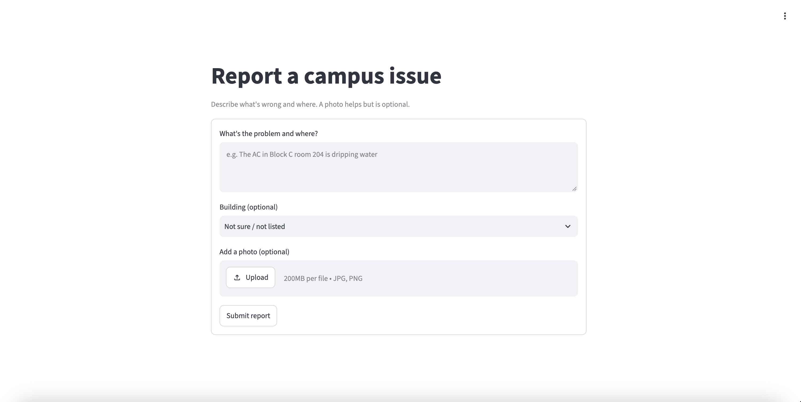

# Smart Campus Faculty Reporting System

An AI-assisted tool for reporting and triaging campus maintenance issues. Students describe a problem in plain language (with an optional photo), and the system turns it into a structured, prioritized ticket for the people who fix it.

**Live demo:** https://scfrsapp.azurewebsites.net
*(Hosted on a free tier, so the first load after a quiet period can take a minute.)*



## The problem

Campus issues like leaking taps, broken lights and dead projectors often go unreported because reporting is slow and form-heavy. When reports do arrive, they are vague and inconsistent, and staff spend time sorting them by hand.

This project makes reporting a 30-second task for students and gives staff reports that are already categorized and ranked by urgency.

**Users**
- **Reporters:** students and staff who notice an issue
- **Resolvers:** facilities staff who triage and fix it

## Status

| Milestone | Status |
|---|---|
| Report form with validation (text, building, optional photo) | Done |
| Cloud storage for reports and photos | Done |
| Deployed live on Azure App Service | Done |
| AI extraction of location, category and urgency | In progress |
| Evaluation of prompt versions on a labeled test set | Planned |
| Staff dashboard sorted by urgency | Planned |
| User testing with students and facilities staff | Planned |

## How it works

```
Student  ->  Streamlit form  ->  Validation  ->  Azure Table Storage (report text, status)
                                             \-> Azure Blob Storage (photo)
                                  (next)  ->  LLM extraction -> category, urgency, summary
```

1. A student writes what's wrong and optionally picks a building and attaches a photo.
2. The app validates the input: minimum and maximum text length, photo size limit, and a check that the upload is a real image.
3. The report text and status are saved to Azure Table Storage, and the photo to a private Azure Blob container.
4. *(Next)* An LLM reads the text and returns structured fields that staff can sort and filter by.

## Planned AI step

Each report will be sent to a language model with a prompt that returns JSON:

- **Location:** building and room, when mentioned
- **Category:** plumbing, electrical, HVAC, IT, furniture, cleaning, other
- **Urgency:** critical, high, medium, low
- **Summary:** one line for the staff list

Because a missed safety hazard is worse than an over-flagged minor issue, the evaluation puts extra weight on catching critical reports.

## Evaluation results

*To be completed once the test set and prompt comparison are done.*

| Prompt version | Category accuracy | Urgency accuracy | Critical recall | Avg latency | Cost per report |
|---|---|---|---|---|---|
| v1 | - | - | - | - | - |
| v2 | - | - | - | - | - |
| v3 | - | - | - | - | - |

## Tech stack

- **Frontend and app:** Python, Streamlit
- **Storage:** Azure Table Storage (reports), Azure Blob Storage (photos)
- **Hosting:** Azure App Service (Linux, Python 3.12)
- **Image validation:** Pillow
- **Config:** python-dotenv
- **AI (planned):** an LLM API with structured JSON output

## Project structure

```
.
├── app.py             # Streamlit report form and validation
├── storage.py         # Saves reports to Azure (or a local folder in local mode)
├── requirements.txt   # Python dependencies
├── env.example        # Template for environment variables
└── README.md
```

## Run it locally

```bash
python -m venv .venv
source .venv/bin/activate          # Windows: .venv\Scripts\activate
python -m pip install -r requirements.txt
python -m streamlit run app.py
```

With no Azure settings, the app runs in local mode and saves reports as JSON files in `./local_data`. A banner on the page shows when this is the case.

## Connect to Azure

1. Create a storage account in the Azure portal (General purpose, Standard, LRS).
2. Copy its **connection string** from *Security + networking > Access keys*.
3. Create your env file and add the string:
   ```bash
   cp env.example .env
   ```
   ```
   AZURE_STORAGE_CONNECTION_STRING=<your connection string>
   ```
4. Restart the app. The local mode banner disappears, and reports appear under *Storage browser > Tables > reports*, with photos under *Blob containers > report-photos*.

`.env` is listed in `.gitignore` and must never be committed.

## Deploy to Azure App Service

```bash
az login
az webapp up --name <app-name> --resource-group <resource-group> \
  --location <region> --runtime "PYTHON:3.12" --sku F1

az webapp config set --name <app-name> --resource-group <resource-group> \
  --web-sockets-enabled true \
  --startup-file "python -m streamlit run app.py --server.port 8000 --server.address 0.0.0.0 --server.headless true"

az webapp config appsettings set --name <app-name> --resource-group <resource-group> \
  --settings AZURE_STORAGE_CONNECTION_STRING="<your connection string>"
```

Set the startup command before the first deploy so Azure knows how to run Streamlit. Use region names without spaces, such as `northcentralus`.

## Design decisions

- **Local fallback:** the app can run without any cloud setup, which makes development and testing quick.
- **Private photo storage:** photos are not publicly accessible. The staff dashboard will use short-lived access links to display them.
- **Minimal personal data:** the form collects no names or contact details in v1.
- **Human in the loop:** AI output will always be shown alongside the original text and photo, so staff can overrule it.

## Roadmap

- [x] Report form with validation
- [x] Azure storage and live deployment
- [ ] Label set and test set of 30 to 50 sample reports
- [ ] Extraction prompt and evaluation script
- [ ] Compare prompt versions on accuracy, latency and cost
- [ ] Save AI fields with each report
- [ ] Staff dashboard with filters and status updates
- [ ] User testing and write-up
- [ ] Photo understanding, duplicate detection, daily digest (stretch)

## Security notes

- Secrets live in `.env` locally and in App Service application settings in production.
- Never commit `.env`. If a key is ever exposed, rotate it in the Azure portal under *Access keys*.
- Set a budget alert in Azure Cost Management, and delete the resource group when the project is finished.
